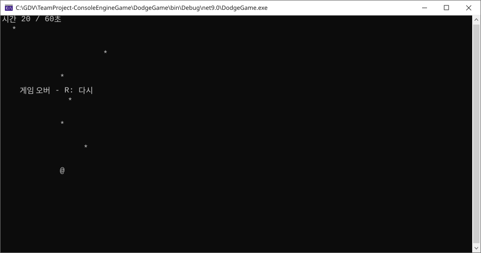
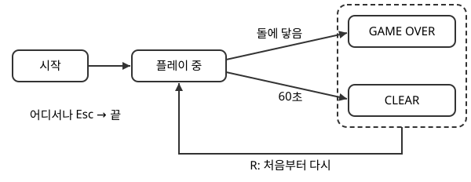

# 피하기 게임 — 기획설계문서 (v1.0)
 
> 플랫폼: Windows · C# 콘솔 앱 · 키보드 (이 실습에서 고정)
 
## 1. 한 줄 소개
위에서 떨어지는 돌을 좌우로 피하며 60초를 버티는 게임.
 
## 2. 최종 목표
돌에 한 번도 맞지 않고 **60초**를 버티면 승리(CLEAR).
 
## 3. 기본 규칙
1. 화면은 가로 30칸 × 세로 20칸. 플레이어 `@`는 맨 아래 줄 가운데에서 시작한다.
2. ←/→ 키를 누를 때마다 한 칸 움직인다. 누르고 있으면 키 반복으로 계속 움직인다. 화면 밖으로는 나갈 수 없다.
3. 돌 `*`은 0.3초마다 맨 윗줄의 무작위 칸에 하나 생겨 초당 10칸 떨어진다.
 - 시간이 지날수록 떨어지는 돌의 갯수가 늘어난다. 15초마다 2배씩 증가한다.
4. 폭탄인 SPACE 키를 누르면 화면에 표시된 모든 돌이 사라진다.
 - 폭탄은 최대 3개 저장할 수 있으며, 5초마다 `O`이 돌처럼 떨어지고 부딪히게 되면 폭탄이 1개 충전된다.
5. 돌이 `@`와 같은 칸에 닿으면 패배(GAME OVER).
6. 버틴 시간을 맨 윗줄에 `시간 12 / 60초`처럼 표시하고, 60초를 채우면 승리(CLEAR).
7. 끝난 화면(GAME OVER·CLEAR)에서 R은 처음부터 다시. Esc는 언제든 게임을 끈다.
 
## 4. 조작
| 키 | 동작 |
|---|---|
| ← / → | 왼쪽 / 오른쪽 한 칸 |
| R | 끝난 화면에서 다시 시작 |
| SPACE | 폭탄 |
| Esc | 종료 |
 
## 5. 화면 구성

 
## 6. 게임 흐름

 
## 7. 만들지 않는 것
사운드, 색, 난이도 단계, 점수 저장
 
## 8. 주제 선정 기록 (2026-11-25 토론)
고른 이유: 규칙이 가장 단순하고, 입력·갱신·렌더링이 모두 한 번씩 필요하다.
 
## 변경 이력
| 버전 | 날짜 | 바뀐 점 | PR |
|---|---|---|---|
| v1.0 | 2026-11-25 | 첫 확정 | #2 |
| v1.1 | 2026-11-26 | 밸런스 수정 | #8 |